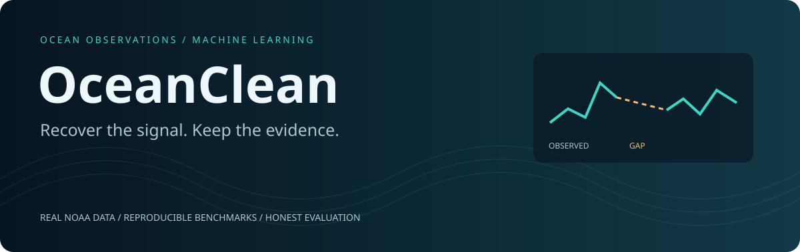
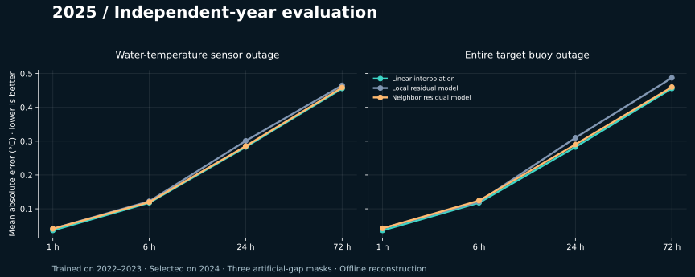
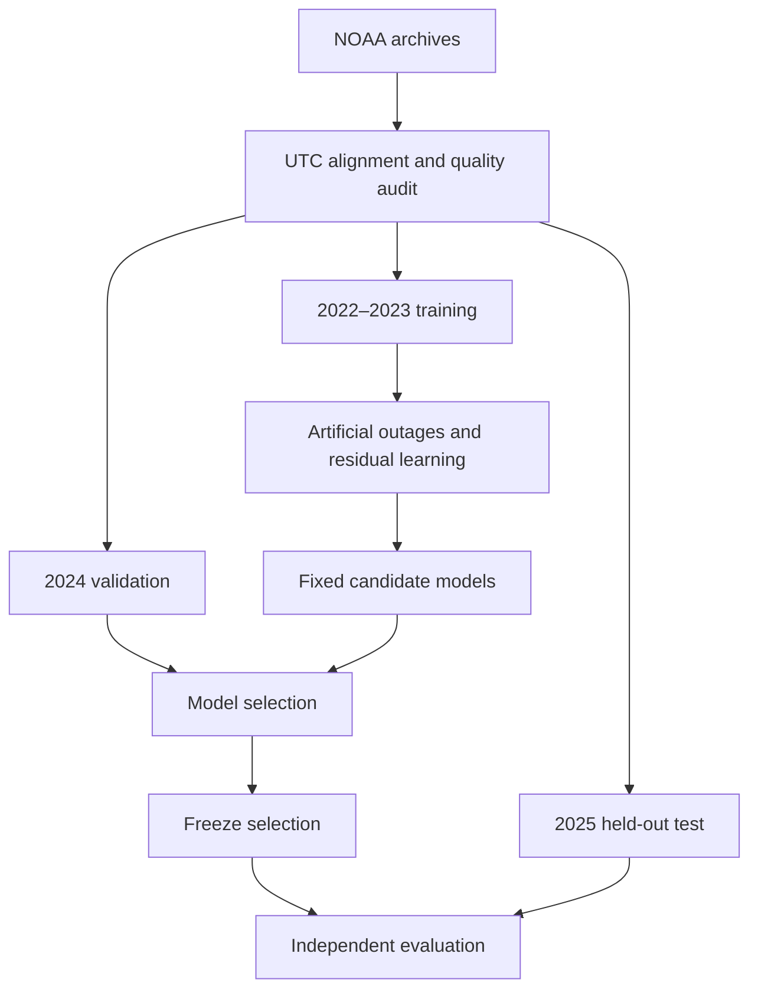

<p align="center"></p>

<p align="center">
  <a href="https://github.com/choppa129/ocean_clean/actions/workflows/tests.yml"></a>
  
  
  
</p>

<p align="center"><b>An end-to-end ML project for reconstructing gaps in ocean buoy observations.</b><br>
Real public data. Explicit missingness. Reproducible experiments. Results you can inspect.</p>

<p align="center"><a href="#explore-the-results">Explorer</a> · <a href="#what-the-experiment-found">Results</a> · <a href="#reproduce-the-experiment">Reproduce</a> · <a href="reports/multiyear/README.md">Experiment report</a> · <a href="docs/technical_guide.md">Technical guide</a></p>

## The question

**When a buoy stops reporting water temperature, can nearby observations help
recover the missing signal?**

OceanClean takes official NOAA archives through ingestion, quality inspection,
controlled outage generation, model training and independent-year evaluation.
It tests both a single broken sensor and a whole target buoy going offline.

| Data | Models | Evaluation |
|:---|:---|:---|
| Target buoy **41009** + neighbor **41010** | Linear interpolation + local/neighbor residual learning | Train **2022–2023**, select **2024**, test **2025** |
| NetCDF metadata, UTC alignment, source hashes | **1,200–43,344** augmented training rows per gap model | **1 / 6 / 24 / 72-hour** artificial outages |

## What the experiment found



**The simplest baseline is still the strongest.** Neighbor information helps the
learned model in the sensor-outage comparison, but does not beat linear
interpolation on the independent 2025 test. The validation-selected 24-hour neighbor
model did not preserve its advantage in the new year.

| Sensor outage | Linear interpolation | Local residual ML | Neighbor residual ML |
|---:|---:|---:|---:|
| 1 hour | **0.0361** | 0.0410 | 0.0409 |
| 6 hours | **0.1179** | 0.1223 | 0.1198 |
| 24 hours | **0.2829** | 0.3009 | 0.2856 |
| 72 hours | **0.4560** | 0.4652 | 0.4588 |

*MAE in °C; lower is better. Means across three evaluation masks, not three independent datasets.*

This negative finding is part of the project: the repository preserves the fixed
protocol, validation selections, failed assumptions and exact metrics.
[Read the complete analysis →](reports/multiyear/README.md)

## Explore the results

Launch the read-only experiment dashboard locally:

```bash
git clone https://github.com/choppa129/ocean_clean.git
cd ocean_clean
python -m pip install -e ".[dashboard]"
python -m streamlit run app/dashboard.py
```

Switch between validation and test years, outage scenarios, MAE/RMSE and gap lengths.
Compare real committed metrics and download the selected table. No data download
or model training is required to browse results. **This explorer is not a live
inference service.**

## How it works



- **Reliable ingestion:** official THREDDS downloads, column-specific fill values,
  checksums and explicit partial-year gaps.
- **Leakage-aware features:** hide target values before interpolation or feature
  construction; keep training and evaluation years separate.
- **Controlled ablations:** compare local-only and neighbor-assisted residual models
  on the same outage masks.
- **Auditable experiments:** versioned protocols, package versions, sample counts,
  validation selection and results.

## Reproduce the experiment

```bash
python -m pip install -e .
OMP_NUM_THREADS=2 OPENBLAS_NUM_THREADS=2 python scripts/run_multiyear.py validate
OMP_NUM_THREADS=2 OPENBLAS_NUM_THREADS=2 python scripts/run_multiyear.py test
python scripts/summarize_multiyear.py
python -m unittest discover -s tests -v
```

Raw downloads and fitted models stay outside git. The first command downloads
training and validation data; the test command retrieves the independent year.
Do not tune on 2025 after inspecting its results. Downloading requires NOAA access.

## Scope & limitations

This is **offline reconstruction**: both gap endpoints are available. It is not
forecasting or validated sensor-fault detection. Artificial outages have known
reference values; true missing values do not. One target buoy and one offshore
neighbor do not establish generalization to other regions. Repeated masking expands
training contexts, not the number of independent measurements.

## Project map

| Location | Purpose |
|---|---|
| [`src/ocean_clean/`](src/ocean_clean/) | Ingestion, masks, features and evaluation |
| [`scripts/`](scripts/) | Reproducible experiments and figure generation |
| [`app/dashboard.py`](app/dashboard.py) | Interactive result explorer |
| [`reports/multiyear/`](reports/multiyear/) | Current experiment, sources and metrics |
| [`reports/first_experiment/`](reports/first_experiment/) | Original pilot and its limitations |
| [`tests/`](tests/) | Parsing, masking, temporal boundaries and leakage checks |

## Next questions

- Which station pairs share useful temperature dynamics?
- Can confidence-aware models decline to correct a good interpolation?
- How does performance change during rapid, genuine temperature events?

These are future experiments, not implemented capabilities or novelty claims.

**Data source:** [NOAA NDBC](https://www.ndbc.noaa.gov/) ·
[Measurement definitions](https://www.ndbc.noaa.gov/faq/measdes.shtml)
