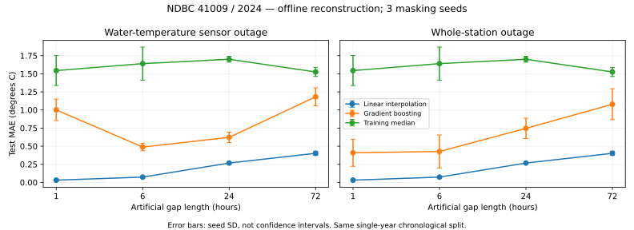

# First real-data experiment

## Outcome

Linear interpolation beats the initial gradient-boosting baseline at all four gap
lengths in both outage scenarios. This is a negative result for the current learned
baseline, not evidence against machine learning in general. No test-driven model
changes were made after this run.



## Data

Official NOAA NDBC THREDDS archive: station 41009, year 2024. 52,692 raw
observations, aggregated into 8,784 UTC hourly bins. Water temperature is observed
in 8,777 bins (7 missing, 0.0797%; longest original gap 3 hours). Visibility and tide
are entirely missing. Other variables and missingness are in `quality.json`.
Text-archive downloads returned HTTP 403 in the execution environment; the official
THREDDS NetCDF archive succeeded. The downloaded file checksum is in `manifest.json`.
Hourly means may contain fewer than six underlying observations; this pilot does
not enforce a minimum within-hour sample count.

## Frozen protocol

- Offline reconstruction: observations on both sides of a gap are permitted.
- Chronological 60/20/20 split; exact dates in `manifest.json`.
- Separate masks in each split; observed endpoints and fully observed target interiors.
- Seeds 42, 43, 44; request 20 nonoverlapping blocks per split and gap length.
- One fixed-hyperparameter gradient-boosting model per seed, gap length and scenario.
- Sensor outage masks WTMP; station outage masks every observed variable.
- No neighboring stations, neural models, calibrated intervals or event labels yet.

## Test MAE, degrees Celsius

Sensor-only outages; average over three masking seeds:

| Gap hours | Linear | Gradient boosting | Training median |
|---:|---:|---:|---:|
| 1 | 0.0311 | 1.0010 | 1.5443 |
| 6 | 0.0733 | 0.4882 | 1.6399 |
| 24 | 0.2675 | 0.6219 | 1.7004 |
| 72 | 0.4016 | 1.1816 | 1.5252 |

Full validation/test metrics for both scenarios: `metrics.csv`; seed summaries:
`summary.csv`. `example_predictions.csv` uses a predeclared seed=42, 24-hour test
gap example set, not a handpicked successful model run. Seeds can overlap in which
hours are evaluated; they are not three independent datasets.

## Interpretation and limitations

The 1-hour learned model sees only 20 masked training labels per seed. Longer-gap
models see more labels, but temporally correlated ones. The training budget is a
small pipeline baseline, not a competitive optimization of gradient boosting.
Tree models also face a seasonal chronological distribution shift; this is a
possible explanation, not a tested causal finding. Interpolation uses nearby known
target endpoints and is especially strong for short smooth gaps.

For 72-hour test gaps only 15–17 blocks fit, depending on seed. Reported counts
make this explicit. These errors describe artificial gaps in archived observations,
not recovery of true missing values and not real sensor-fault detection. One
station/year and overlapping masks do not support broad generalization claims.

## Reproduction

```bash
pip install -e .
python scripts/run_first_experiment.py
# optional visualization
pip install matplotlib
python scripts/plot_first_experiment.py
```

Raw NetCDF and processed CSV remain in ignored `data/raw/`; full point predictions
are in ignored `outputs/`. Source URL, hashes, package versions, splits and all
aggregate metrics are committed. Archive revisions can change hashes and results.

## Next experiment

Freeze an additional later-year holdout before model development. Expand training
corruption examples using training data only, compare interpolation-residual learning,
and validate neighbor features before revisiting the test set. Treat this pilot's
test set as already inspected, not an untouched final benchmark.
