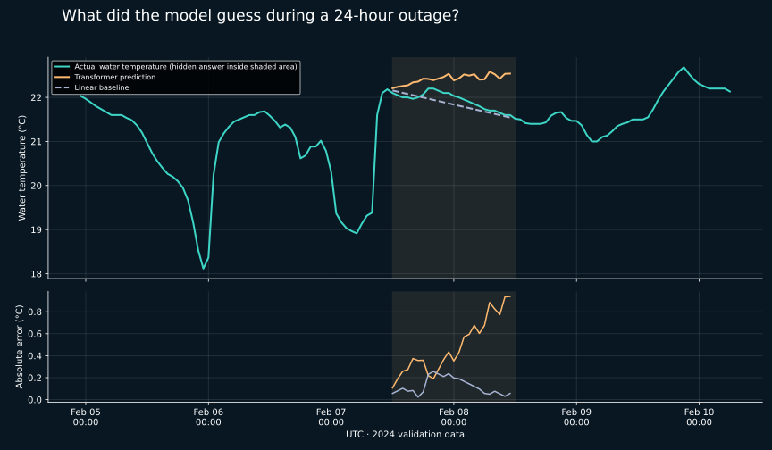

# A paired, visible reconstruction example

The shaded region contains 24 hourly water-temperature measurements deliberately
hidden from both methods. Green is the actual answer; orange is the Transformer;
the dashed line is interpolation. The lower panel shows absolute error.
The example is the first eligible 24-hour window in the fixed validation sequence,
not a case chosen by model performance.

## Example errors

| window_id | gap_hours | model | mae | rmse |
| --- | --- | --- | --- | --- |
| 2 | 24 | transformer | 0.4858 | 0.5458 |
| 2 | 24 | linear | 0.1207 | 0.1410 |

## Paired comparison across the original validation windows

Both methods use the same 128-hour target context and score exactly the same
hidden values. The Transformer also sees available weather and neighbor channels;
the linear baseline only uses target water temperature. No retraining occurred.
These are 2024 validation data already used to choose the checkpoint, not a new
independent test. Overlapping windows are not independent samples.

| gap_hours | model | mae | points | rmse |
| --- | --- | --- | --- | --- |
| 1 | linear | 0.0364 | 64 | 0.0545 |
| 1 | transformer | 0.6608 | 64 | 0.8039 |
| 6 | linear | 0.1085 | 384 | 0.1616 |
| 6 | transformer | 0.7103 | 384 | 0.9452 |
| 24 | linear | 0.3850 | 1536 | 0.5659 |
| 24 | transformer | 0.7209 | 1536 | 1.0017 |
| 72 | linear | 0.4984 | 4608 | 0.7396 |
| 72 | transformer | 0.7350 | 4608 | 0.9953 |

The current Transformer is less accurate than the simple baseline in this paired
comparison. This confirms an implementation that runs, not a performance advance.
The next modeling decision should be based on observed error behavior and validation
experiments; do not claim that model complexity implies better reconstruction.

Reproduce: `python scripts/compare_transformer.py` (install the deep and dashboard
extras, and download both 2024 source CSVs first).

Follow-up: [bias and neighbor-use diagnosis](../transformer_diagnostics/). The illustrated
window has no observed neighbor channels; it cannot demonstrate neighbor benefit.
