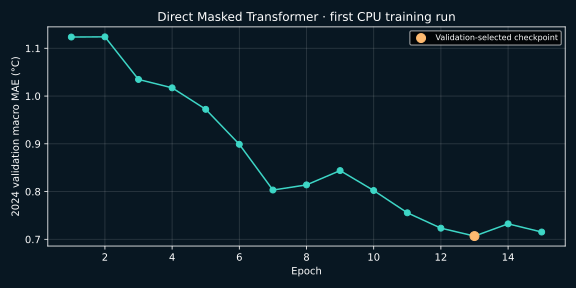

# Direct masked spatiotemporal Transformer

A PyTorch implementation that reconstructs hidden water temperature directly.
**No interpolation values or residual-to-interpolation targets are used.**

## Architecture

Each hourly station token contains four standardized observed values (water
and air temperature, wind speed, pressure) and four availability indicators.
Missing inputs are zero after standardization and are distinguished by their masks.
Learned station and position embeddings are added. Two temporal Transformer blocks
operate independently per station; cross-station attention then fuses information
for the target buoy. A linear head predicts normalized target water temperature.
The model has 25,857 parameters at width 32, with four attention heads.

## Protocol

- Training years: 2022 and 2023. Normalization is fitted only on these years.
- Validation year: 2024; used for best-epoch selection.
- 2025 is not loaded by this trainer and is not used for selection.
- 128-hour windows with artificial 1/6/24/72-hour target gaps.
- Original missing target values never become training labels.
- Loss: mean squared error on artificially hidden target entries only.
- Selection: mean validation MAE across the four gap lengths.
- Current training is sensor-only outage, not whole-target-station outage.
- Windows/masks may overlap, and remain fixed across epochs; this is not an
  independent-sample uncertainty estimate.

The previous baseline experiment uses different masks/context, so its metrics are
not a paired comparison with this run. No superiority claim is made. This compact
model is an initial deep-learning implementation, not a published method reproduction
or research-novel architecture. It has no calibrated uncertainty estimates.

## Train

```bash
pip install -e ".[deep]"
# Fetch 41009 and 41010 for each of 2022, 2023 and 2024 if absent:
# ocean-clean download --station 41009 --year 2022 --source thredds
python scripts/train_transformer.py --epochs 15 --samples 2048 \
  --validation-samples 256 --out outputs/transformer_v1
```

The script automatically uses CUDA when available. Small defaults permit a CPU
smoke run. The committed v1 report records a CPU run. Larger runs can set `--width`,
`--layers`, `--samples`, `--epochs`, and `--batch-size`; no GPU run is claimed here.

## Reconstruct a window

Supply a target CSV containing missing WTMP values and an aligned neighbor CSV.
Known observations are preserved in the output. No synthetic missingness is added
by the inference command.

```bash
python scripts/reconstruct_transformer.py \
  --checkpoint reports/transformer/checkpoint \
  --target-csv data/raw/41009h2024.csv \
  --neighbor-csv data/raw/41010h2024.csv \
  --start 2024-01-01T00:00:00Z
```

Use station inputs in the order recorded by the checkpoint (41009 then 41010).
The model uses both past and future context within the 128-hour window. Arbitrary
edge gaps and all-missing windows are not validated deployment conditions.

## Recorded v1 run



15 CPU epochs; 2,048 training windows and 256 validation windows. Best epoch: **13**. Validation macro MAE: **0.7068 °C**.

| Hidden hours | Validation MAE (°C) |
|---:|---:|
| 1 | 0.6608 |
| 6 | 0.7103 |
| 24 | 0.7209 |
| 72 | 0.7350 |

These are validation-selected development metrics, not independent test results.
